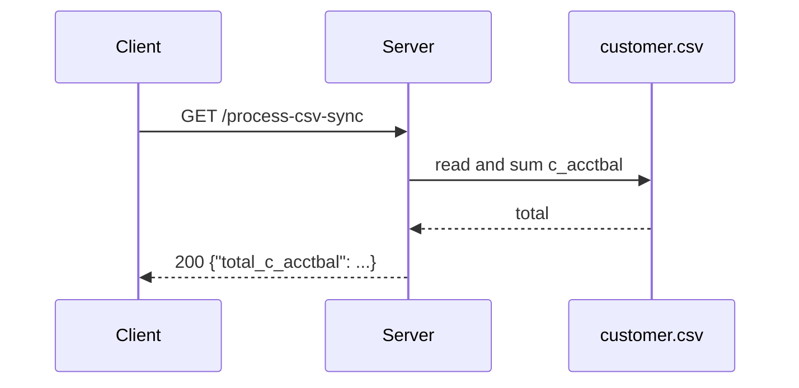
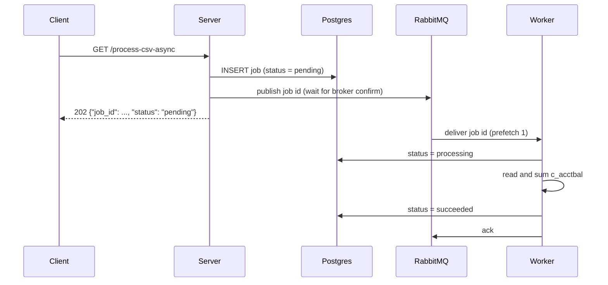
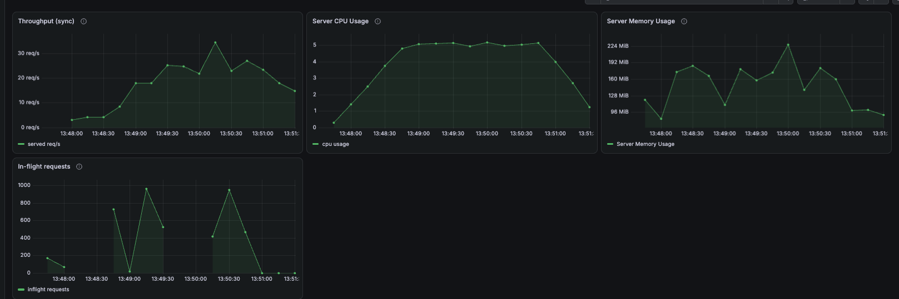
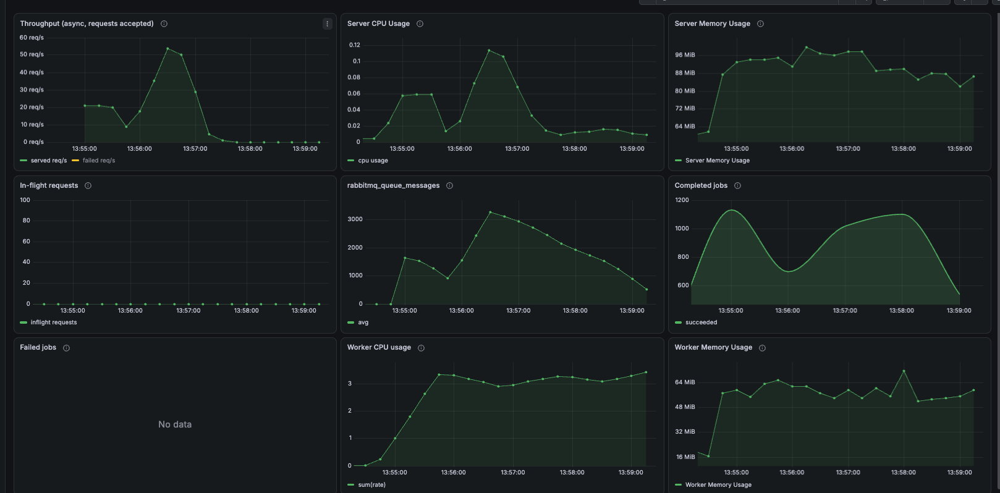

# Observing a time-consuming endpoint under load

This project compares two ways of exposing the same slow operation over HTTP, and
shows how each behaves under heavy load using Prometheus, Loki, Tempo and Grafana.

The operation: read a large customer CSV (`server/data/customer.csv`) and sum its
`c_acctbal` column. It takes long enough that how you structure the endpoint matters.

| Endpoint                  | Style | What the request does                                         | Response            |
|---------------------------|-------|---------------------------------------------------------------|---------------------|
| `GET /process-csv-sync`   | Sync  | Processes the CSV inside the request handler                  | `200` with the total |
| `GET /process-csv-async`  | Async | Creates a job, queues it, returns immediately                 | `202` with a job id |
| `GET /healthz`            | -     | Checks Postgres and the RabbitMQ connection                   | `200` / `503`       |

## Architecture

### Sync

The request holds a connection and a server goroutine for the whole duration of the
work. Under load, in-flight requests, goroutines, CPU and memory on the **server** grow
with the number of concurrent clients, and latency grows with them.



### Async

The server only records the job and queues it, so the request finishes in milliseconds.
A separate **worker** service does the CSV processing at its own pace, bounded by its
consumer count. Load turns into queue depth instead of server pressure.



Details:

- **Job state** lives in the Postgres `jobs` table (`pending`, `processing`, `succeeded`, `failed`), see [server/init.sql](server/init.sql).
- **Queue** is a durable RabbitMQ queue, `export_jobs`. Messages are persistent and the server waits for the broker's publish confirm, so an accepted job is not lost.
- **Publishing** uses a pool of confirm-mode channels (`PUBLISHER_CHANNELS`, default 10), since AMQP channels are not goroutine-safe.
- **Consuming**: the worker runs `CONSUMER_COUNT` consumers (default 5 in compose), each with prefetch 1, so at most that many jobs run at once.
- **Failures**: if processing fails, the message is nacked and requeued. If the publish fails, the job is marked `failed` and the API returns `500`.
- **Tracing**: the trace context is carried in the AMQP message headers, so one trace spans API request, queue publish, worker processing and DB updates.

### Sync vs async at a glance

|                         | Sync                              | Async                                      |
|-------------------------|-----------------------------------|--------------------------------------------|
| Response time           | As long as the work               | Time to insert a row and publish a message |
| Where the work runs     | Server process                    | Worker process                             |
| Concurrency of the work | Unbounded (one per request)       | Bounded by consumers                       |
| Under overload          | Server slows down, may fail       | Queue grows, jobs wait                     |
| Result                  | In the response                   | Job status in Postgres                     |

## Results

Grafana captures from a stress run against each endpoint.

### Sync



The work runs inside the server, so load shows up on the server itself: CPU stays pinned
at about 5 cores, memory swings between roughly 90 and 225 MiB, throughput peaks around
35 req/s, and in-flight requests spike to nearly 1000.

### Async



The server only inserts a row and publishes a message, so its CPU stays low (peak about 0.11)
and memory flat (about 85-100 MiB), with in-flight requests staying at 0. Accepted-request
throughput peaks around 50 req/s. The backlog builds in RabbitMQ (up to about 3000 messages)
and drains steadily while the worker, bounded by its consumer count, runs at about 3 cores.

## Services

All wired together in [compose.yml](compose.yml).

| Service           | Role                                                                | Port         |
|-------------------|---------------------------------------------------------------------|--------------|
| `server`          | HTTP API (sync and async endpoints) and its Prometheus metrics      | 8080, 9464   |
| `worker`          | RabbitMQ consumers that process async jobs                          | -            |
| `postgres`        | Job storage                                                         | -            |
| `rabbitmq`        | Job queue (management UI, guest/guest)                              | 15672        |
| `cgroup-exporter` | Custom Go exporter, per-container CPU/memory/IO/pids from cgroup v2 | 9100         |
| `prometheus`      | Scrapes and stores metrics                                          | 9090         |
| `loki` / `promtail` | Container logs                                                    | 3100         |
| `tempo`           | Distributed traces (OTLP)                                           | -            |
| `grafana`         | Dashboards (admin / admin)                                          | 3000         |

## Load generator

[client/index.js](client/index.js) fires bursts of requests at one endpoint, waits for
them to settle, pauses, and repeats. Pick the endpoint with `SERVER_URL`.

| Variable            | Default                                    | Meaning                          |
|---------------------|--------------------------------------------|----------------------------------|
| `SERVER_URL`        | `http://localhost:8080/process-csv-async`  | Endpoint to hit                  |
| `TOTAL_REQUESTS`    | `10000`                                    | Requests per round               |
| `MAX_ITERATIONS`    | `10`                                       | Number of rounds                 |
| `ROUND_INTERVAL_MS` | `1000`                                     | Pause between rounds             |
| `TIMEOUT_MS`        | `60000`                                    | Per-request timeout              |

## Running it

The CSV is not committed (`server/data` is git-ignored). Put the file at `server/data/customer.csv`
with a `c_acctbal` column, then:

```sh
docker compose up -d --build

cd client
npm install

# async
SERVER_URL=http://localhost:8080/process-csv-async npm start

# sync
SERVER_URL=http://localhost:8080/process-csv-sync npm start
```

Open Grafana at <http://localhost:3000> and compare the dashboards:

- **Stress Test - Sync**: throughput, server CPU/memory, in-flight requests.
- **Stress Test - Async**: accepted-request throughput, in-flight requests, queue depth (`rabbitmq_queue_messages`), completed and failed jobs, server and worker CPU/memory.
- **Jobs (Postgres)**: jobs by status, created and completed per interval.
- **Stress Testing Observation**: server-side view with in-flight requests, connections and goroutines.

Server metrics worth watching: `server_inflight_requests`, `server_connections{state}`,
`server_goroutines` and `server_jobs{status}` (read from Postgres at scrape time).
